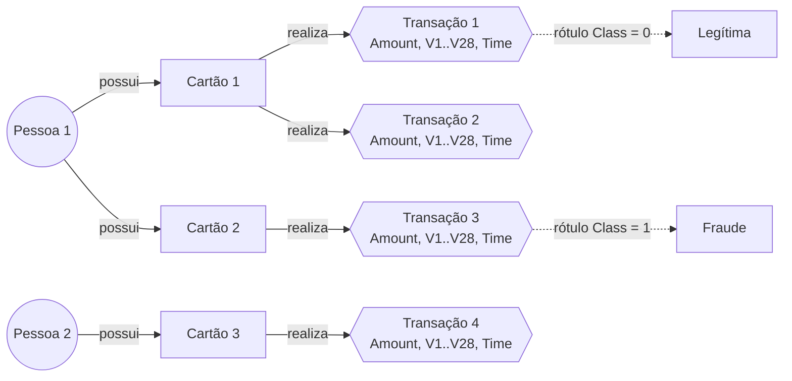

# Grafo de relacionamentos: pessoas, cartões e transações

> **Diagrama ilustrativo.** Ele mostra como uma base real de cartões costuma se organizar. O dataset ULB usado neste projeto **não tem** identificadores de pessoa nem de cartão, então estas relações não podem ser extraídas dele.

## Relações ilustrativas

## O que o projeto usa, e o que não usa

| Elemento | Existe no dataset ULB? | Como o projeto usa |
|---|---|---|
| Transação | Sim: uma linha por transação | Unidade de análise. Cada linha é classificada de forma independente. |
| Atributos da transação | Sim: `Time`, `V1` a `V28` (componentes PCA), `Amount` | Entrada do modelo. Só `Time` e `Amount` são escalonados. |
| Rótulo da transação | Sim: `Class` (0 ou 1) | Alvo do treino e da avaliação. |
| Cartão | **Não** | Não é usado. |
| Pessoa | **Não** | Não é usada. |

## Consequências para o projeto

- **Não há arestas entre transações.** O modelo não aprende padrões como "várias compras seguidas no mesmo cartão" ou "cartões ligados à mesma pessoa". Esses padrões dependem de identificadores que o dataset não oferece.
- **A divisão treino/validação/teste é feita por linha.** Se o dataset tivesse cartão, o correto seria dividir **por cartão**, para que nenhum cartão aparecesse em dois conjuntos. Caso contrário, o modelo poderia memorizar o comportamento de um mesmo cartão e inflar as métricas.
- **Uma extensão possível** seria construir um grafo com dados reais que tenham identificadores (por exemplo, um dataset próprio ou um conjunto anonimizado com ID de cartão). Isso mudaria a modelagem, e a divisão teria de ser por grupo.
